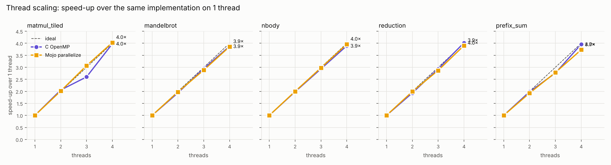
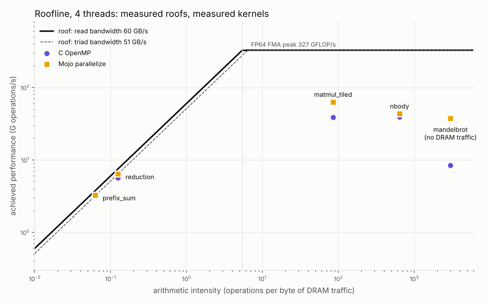

# mojo-bench

How fast is Mojo in practice? This repository compares **Mojo** with **pure Python**, **NumPy** and **C** on eight classic kernels, on the same machine, with the same inputs, checking that every implementation produces the same answer before any time is reported. It also measures how the parallel kernels scale across cores and places them on a roofline built from this machine's measured limits.

It is meant to be honest rather than flattering: where Mojo wins, the analysis says why; where it does not, that is reported too. Every number below was measured by `make bench` and is in [`results/`](results/). A longer, blog-style write-up is in [`docs/writeup.md`](docs/writeup.md).


## What is compared, and why

| Kernel | What it stresses | Size used |
|---|---|---|
| `matmul_naive` | Textbook i-j-k triple loop; strided memory access, no blocking | 384 × 384 float64 |
| `matmul_tiled` | Cache blocking + SIMD over the inner loop | 384 × 384 float64 |
| `mandelbrot` | Pure compute with a data-dependent early exit (branchy, hard to auto-vectorise) | 640 × 640 pixels, 200 max iterations |
| `nbody` | O(n²) floating-point maths with `sqrt` and division | 1,024 bodies, 5 steps |
| `reduction` | Streaming sum; memory bandwidth | 10 M int64 |
| `prefix_sum` | Inclusive scan; a serial dependency chain plus a write stream | 10 M int64 |
| `hash_table` | Random memory access, branches; 2 M inserts then 2 M lookups (50 % hits) | 2 M keys |
| `word_count` | String processing: tokenising bytes, hashing and counting variable-length words | 4 M words (21.8 MB of text) |

The implementations:

- **Python**: lists, loops, `dict` and `collections.Counter`, written the way a competent Python programmer would without extension modules. This is the baseline (1×) and the source of truth for correctness.
- **NumPy**: the idiomatic "make Python fast" route, only where a natural array formulation exists. A naive triple loop and an open-addressing hash table have no sensible NumPy form, so they are shown as n/a. For `matmul_tiled`, NumPy's `a @ b` calls OpenBLAS: an expertly tuned GEMM, so treat it as the ceiling rather than a like-for-like peer.
- **C (1 thread)**: plain C compiled with `gcc -O3 -march=native` (GCC's default dialect), no intrinsics. Any SIMD comes from GCC's auto-vectoriser, which is what most C code actually gets.
- **C OpenMP (all cores)**: the same source compiled with `-fopenmp`, with OpenMP pragmas on the five kernels that parallelise naturally.
- **Mojo (1 thread)**: idiomatic Mojo 1.2 using explicit SIMD types and `vectorize` where it helps.
- **Mojo (all cores)**: the same code split into one chunk per core with `parallelize`, for the same five kernels.

The fair, like-for-like comparisons are **C (1 thread) against Mojo (1 thread)** and **C OpenMP against Mojo (all cores)**.

## Results

Machine: Intel Xeon (Sapphire Rapids, AVX-512) cloud VM with 4 vCPUs, Ubuntu 24.04, gcc 13.3.0 (`-O3 -march=native`), Mojo 1.2.0, Python 3.13.18, NumPy 2.5.3. Full details are in [`results/results.md`](results/results.md) and [`results/machine.json`](results/machine.json).

### Median time

| Kernel | Python | NumPy | C (1 thread) | C OpenMP (4 threads) | Mojo (1 thread) | Mojo (4 threads) |
|---|---:|---:|---:|---:|---:|---:|
| matmul_naive | 2.48 s | n/a | 69.0 ms | n/a | 72.1 ms | n/a |
| matmul_tiled | 2.46 s | 1.9 ms | 9.2 ms | 3.6 ms | 6.3 ms | 1.7 ms |
| mandelbrot | 2.04 s | 359.0 ms | 82.5 ms | 21.6 ms | 19.0 ms | 4.8 ms |
| nbody | 1.00 s | 88.8 ms | 10.5 ms | 2.9 ms | 9.3 ms | 2.5 ms |
| reduction | 73.6 ms | 3.0 ms | 3.2 ms | 860 µs | 3.1 ms | 839 µs |
| prefix_sum | 580.3 ms | 36.2 ms | 16.9 ms | 2.7 ms | 14.7 ms | 3.2 ms |
| hash_table | 911.5 ms | n/a | 96.5 ms | n/a | 102.4 ms | n/a |
| word_count | 615.4 ms | 517.7 ms | 79.5 ms | n/a | 83.1 ms | n/a |

### Speed-up over pure Python (higher is better)

| Kernel | NumPy | C (1 thread) | C OpenMP (4 threads) | Mojo (1 thread) | Mojo (4 threads) |
|---|---:|---:|---:|---:|---:|
| matmul_naive | n/a | 35.9× | n/a | 34.3× | n/a |
| matmul_tiled | 1,325× | 268× | 677× | 392× | 1,439× |
| mandelbrot | 5.7× | 24.7× | 94.3× | 107× | 421× |
| nbody | 11.3× | 95.9× | 342× | 108× | 394× |
| reduction | 24.5× | 22.7× | 85.5× | 23.7× | 87.7× |
| prefix_sum | 16.0× | 34.3× | 211× | 39.5× | 182× |
| hash_table | n/a | 9.4× | n/a | 8.9× | n/a |
| word_count | 1.2× | 7.7× | n/a | 7.4× | n/a |

### Start-up and compile costs

| What | Median wall time |
|---|---:|
| Python interpreter start (no-op) | 19.4 ms |
| Python + `import numpy` (no-op) | 92.8 ms |
| C binary start (no-op) | 1.3 ms |
| Mojo binary start (no-op) | 8.4 ms |
| `gcc -O3` compile of `kernels.c` | 310 ms |
| `mojo build` of `kernels.mojo` | 1.88 s |
| `mojo run kernels.mojo` (JIT compile + run, no-op) | 1.88 s |

## Analysis: where Mojo wins, where it doesn't, and why

**Same algorithm, same machine code: no difference.** On `matmul_naive`, C and Mojo are within 5 % of each other (69.0 vs 72.1 ms, about 1.6 GFLOP/s each). Both are scalar loops walking down a column of B with a stride of 384 × 8 bytes, and neither compiler may reorder the floating-point sum. Mojo is not magic: written the same way as C, it compiles to much the same code and runs at the same speed. The ~35× over Python is simply the cost of the interpreter.

**Explicit SIMD is where Mojo pulls ahead.** The clearest case is `mandelbrot`: Mojo is **4.3× faster than C** on one core (19.0 vs 82.5 ms) and 4.5× faster than C with OpenMP on four (4.8 vs 21.6 ms). The escape-time loop has a data-dependent exit, which GCC's auto-vectoriser will not touch, so the C code processes one pixel at a time. The Mojo version uses `SIMD[DType.float64, 8]` vectors, so 8 pixels per AVX-512 register, with a mask that freezes escaped lanes and a loop that ends when all 8 have escaped. This is the case Mojo is designed for: SIMD as a normal, portable type in the language rather than compiler-specific intrinsics. A C programmer *could* write the same thing with AVX-512 intrinsics. The point is that idiomatic C doesn't, and idiomatic Mojo does.

**Sometimes the difference is a compiler default, not the language.** On `matmul_tiled`, Mojo is 1.46× faster than C on one core (6.3 vs 9.2 ms; 18.0 vs 12.3 GFLOP/s) with the same blocked i-k-j algorithm. The cause is measurable: GCC detects this CPU as Sapphire Rapids but defaults to `-mprefer-vector-width=256`, so it uses half-width AVX-512 vectors. In a separate 30-repeat run, rebuilding the C with `-mprefer-vector-width=512` brought it to **6.6 ms**, level with Mojo. The same flag made the C n-body *slower* (10.6 → 13.3 ms), which is why GCC is cautious by default. Mojo's `simd_width_of[DType.float64]()` picks the full 8-lane width. To reproduce:

```bash
gcc -O3 -march=native -mprefer-vector-width=512 -o build/kernels_c512 kernels/c/kernels.c -lm
```

```bash
./build/kernels_c512 matmul_tiled 384 2 30
```

A second compiler detail mattered here too. An earlier version of this benchmark compiled the C with `-std=c11`, which, as a side effect, stops GCC fusing `a*b + c` into a single FMA instruction (in its strict ISO C modes GCC treats floating-point contraction as off). The C binary then contained no FMA instructions at all, against 55 in the Mojo binary, and the tiled C matmul was 10.4 ms instead of about 9 ms. The C here now uses GCC's default dialect, as a plain `gcc -O3 -march=native` would. Each of these flags moved a result by 15–25 %, so benchmark comparisons must state them.

**When the compiler already vectorises, it's a tie.** On `nbody`, C and Mojo differ by about 13 % (10.5 vs 9.3 ms; roughly 500–560 M pair interactions per second). GCC auto-vectorises the inner loop of the C code, including `sqrt` and division, so writing it with explicit SIMD in Mojo gains little. `reduction` (3.2 vs 3.1 ms) and `prefix_sum` (16.9 vs 14.7 ms) are also within run-to-run noise. The scan has measured anywhere from 14.7 to 16.9 ms for Mojo across runs.

**Memory-bound kernels: everyone hits the same wall.** A single core sums the 80 MB `reduction` array at about 25–27 GB/s in C, Mojo *and* NumPy. At that point the limit is how fast one core can pull data in, not the language. NumPy is level with compiled code here because `a.sum()` is a single call into a C loop with no per-element Python overhead. The 80 MB array fits in the 260 MB of L3 that the VM reports, so this is cache bandwidth. The roofline section below uses 800 MB arrays to measure DRAM.

**Pointer chasing: Python's dict is already C.** `hash_table` shows one of the smallest gaps: C and Mojo do an insert or lookup in about 24–26 ns, Python in about 230 ns, so roughly 9×. Python's `dict` is a highly optimised C hash table, so what you pay for in Python is interpreter dispatch and boxed integers, not the hashing. The compiled versions are limited by cache misses on a 64 MB table, which no language feature removes.

**Strings: the smallest gap of all, and NumPy barely helps.** `word_count` tokenises 21.8 MB of text and counts about 4,700 distinct words. C and Mojo take 80–83 ms (about 20 ns per word, roughly 270 MB/s), only **7.4–7.7× faster than Python's `Counter(text.split())`**. Both `str.split` and `Counter` run in C inside CPython, so idiomatic Python is already mostly native code here. The vectorised NumPy version (find word boundaries with array operations, build an exact integer key per word, then `np.unique`) is only 1.2× faster than plain Python: sorting 4 M keys and the many temporary arrays cost as much as they save. Neither C nor Mojo uses SIMD in this kernel (it is a byte-at-a-time state machine plus a hash-table probe), and they are level with each other.

**Parallelism: same speed-up in both languages.** With 4 threads, Mojo's `parallelize` and C's OpenMP give similar speed-ups over their own single-threaded code: 3.9× and 3.8× on Mandelbrot, 3.7× and 3.6× on n-body, 3.7× and 3.8× on reduction. The absolute gaps on four cores are the single-core gaps carried over (Mandelbrot, tiled matmul). The tiled matmul is the exception: C/OpenMP scales only 2.5× at this size against Mojo's 3.7×, so on four cores Mojo is 2.1× faster (1.7 vs 3.6 ms). At n = 384 each thread gets only a few 64-row blocks, so how the blocks are divided up matters. At n = 1,024 in the scaling study both scale 4.0×. At this size both languages show more than 4× on the scan (4.6× Mojo, 6.2× C), which four cores cannot explain on their own. The scaling study, at a larger size, shows a sane 3.7–4.0×. Treat the small-size scan numbers as unreliable. Mojo's best matmul, 66 GFLOP/s on 4 cores, only just beats single-threaded OpenBLAS (61 GFLOP/s): hand-tuned micro-kernels still get about four times as much out of each core as a straightforward tiled loop.

**Start-up and compile cost are real.** A compiled Mojo binary takes about 8–10 ms to start, against 1.3 ms for C: it initialises its runtime and thread pool. Compilation is the bigger cost: `mojo build` takes about 1.9 s for this file against 0.3 s for `gcc -O3`. `mojo run` pays that compile on *every* invocation, so for a script that does under a second of work, Python (about 20 ms to start) or a pre-built binary is the better choice. All kernel timings above exclude start-up and compilation.

### Summary

- Mojo is not a faster C. Written like C, it runs like C.
- Its advantage is that SIMD and parallelism are first-class and portable. `mandelbrot` (4.3× over C on one core, 4.5× over OpenMP on four) shows that clearly. `parallelize` scales as well as OpenMP, with a few lines of code.
- Compared with Python, the speed-ups range from about 7× (strings, hash tables) to over 1,000× (blocked matmul on 4 cores). Most of that gain is also available from C, and for array-shaped problems NumPy gets a good part of the way with no new language.

## Thread scaling

[`bench/scaling.py`](bench/scaling.py) runs each parallel kernel on 1 to 4 threads through its parallel code path, at sizes larger than the main benchmark: the two streaming kernels use 800 MB arrays, far beyond the L3 cache, so they hit DRAM. Speed-up is relative to the same implementation on 1 thread. Full table: [`results/scaling.md`](results/scaling.md).



| Kernel (size) | C OpenMP, 4 threads | Mojo, 4 threads |
|---|---:|---:|
| matmul_tiled (1,024²) | 3.98× (220 → 55 ms) | 4.03× (137 → 34 ms) |
| mandelbrot (2,048²) | 3.88× (830 → 214 ms) | 3.86× (186 → 48 ms) |
| nbody (4,096 bodies) | 3.90× (168 → 43 ms) | 3.96× (153 → 39 ms) |
| reduction (100 M) | 4.02× (71 → 18 ms) | 3.91× (61 → 16 ms) |
| prefix_sum (100 M) | 3.96× (246 → 62 ms) | 3.73× (227 → 61 ms) |

**Where does scaling flatten, and why?** On this 4-vCPU machine, it barely does. The compute-bound kernels (matmul, Mandelbrot, n-body) scale almost perfectly to 4 threads in both languages, because each thread works on its own rows or bodies and shares nothing but read-only inputs. The memory-bound kernels also scale nearly linearly, but for a different reason, and they run out of room at exactly 4 threads:

- One core can only stream about 13–15 GB/s (measured, below), because a core can have only a limited number of cache-line requests in flight. Adding cores adds bandwidth, so up to 4 threads the streaming kernels scale too.
- At 4 threads, the reduction moves 45–51 GB/s and the two-pass scan 51.6–52.5 GB/s (it reads its input twice, then writes and write-allocates its output: 32 bytes per element). That is at the 51 GB/s STREAM-triad bandwidth measured on all 4 threads, so the scan is at the memory roof and the reduction close to it. A fifth core would not make them much faster unless the platform has spare bandwidth that a 4-vCPU slice cannot reach.
- Short runs flatten much earlier. In the main benchmark, where a 4-thread tiled matmul takes under 4 ms, C/OpenMP managed only 2.5×. Thread start-up, synchronisation and load imbalance between a handful of 64-row blocks are a large fraction of so little work.

One run of the scaling study showed Mojo's scan at only 3.1× on 4 threads. The next run, committed here, showed 3.7×. The 4-thread figures for the streaming kernels move by about ±10 % between runs on this shared VM.

## Roofline analysis

[`bench/roofline.py`](bench/roofline.py) measures this machine's roofs with [`kernels/c/roofline_probe.c`](kernels/c/roofline_probe.c), takes the best of three runs, and places the 4-thread scaling results on a roofline. Full table and operation counts: [`results/roofline.md`](results/roofline.md).

| Measured roof | 4 threads | 1 thread |
|---|---:|---:|
| Peak FP64 FMA throughput (512-bit FMA chains) | 327 GFLOP/s | 84 GFLOP/s |
| Memory bandwidth, read-only sweep | 60.0 GB/s | 14.9 GB/s |
| Memory bandwidth, STREAM triad | 51.0 GB/s | 12.8 GB/s |

The ridge point is 327 / 60 ≈ **5.4 operations per byte**: a kernel needs at least that many operations per byte of DRAM traffic before compute, rather than memory, can be its limit.



| Kernel | Intensity (op/byte) | Bound | Best achieved (4 threads) | Share of its roof |
|---|---:|---|---:|---:|
| reduction | 0.125 | **memory** | 51 GB/s (Mojo), 45 GB/s (C) | 85 % (Mojo), 75 % (C) of read bandwidth |
| prefix_sum | 0.0625 | **memory** | 52 GB/s (Mojo and C) | ~100 % of triad bandwidth |
| matmul_tiled | ≤ 85 | compute | 63 GFLOP/s (Mojo) | 19 % of FMA peak |
| nbody | ~640 | compute | 44 GFLOP/s (Mojo) | 13 % of FMA peak |
| mandelbrot | ∞ (no array traffic) | compute | 37 GFLOP/s (Mojo), 8 (C) | 11 % (Mojo), 3 % (C) |

How the intensities were estimated, and what the gaps mean:

- **Reduction and scan are firmly memory-bound** (intensity 0.06–0.13 op/byte, 40–90 times below the ridge). Mojo's reduction reaches 85 % of the measured read bandwidth and C's 75 %, and both scans reach the triad bandwidth. Little is left to gain from either language: only moving less data would help.
- **Matmul is compute-bound in principle**: 2n³ flops over at least 3·8n² bytes of compulsory traffic gives up to 85 flop/byte. Yet it reaches only 19 % of peak. Simple tiling leaves the loop limited by loads and stores into the C block rather than by FMA throughput. Register blocking, packing and prefetching are exactly what OpenBLAS adds, and why it reaches 61 GFLOP/s on a *single* core.
- **N-body is compute-bound** (about 20 flops per pair against 16 doubles per body per step), but the FMA peak is not its real ceiling. Each pair needs a square root and a division, and those units have far lower throughput than the FMA units. The 13 % figure is relative to an FMA-only roof the kernel can never reach. I did not measure divide/square-root throughput separately.
- **Mandelbrot moves no data**, so it is purely compute-bound. The C version's 3 % of peak is the cost of scalar code: one pixel per instruction, and each iteration depends on the last. Mojo's masked 8-lane SIMD gets 4.5× more, at 11 %. The rest goes on the long dependency chain within each pixel and on lanes that keep computing after their pixel has escaped.

Caveat: the roofs and the kernel timings were measured minutes apart on a shared VM, and the operation and byte counts are estimates (stated in `results/roofline.md`). Read the percentages as ±15 %.

## Benchmarking caveats

- **One machine.** This is a 4-vCPU cloud VM (`hypervisor` flag set), shared with other tenants. Results will differ on your hardware, especially for memory-bound kernels, and four cores cannot show where scaling flattens on a full socket.
- **Noise.** Repeats are adaptive: at least 5, otherwise as many as fit in about 1 s, capped at 200. Across two complete runs, medians agreed within about 3 % for most rows and within 7 % for every single-threaded row except NumPy n-body (13 %). Several very short 4-thread runs (tiled matmul, reduction and scan, all under 4 ms) varied by 10–20 % between runs, and the scan more than that. The single-threaded C tiled matmul also moved by up to ±10 % with code changes elsewhere in the file that did not touch its loop, which looks like code-layout and alignment sensitivity. Treat differences under about 10–15 % as a tie.
- **Medians, warm caches.** Each implementation has one warm-up run, and times are medians of the timed repeats. Input generation is excluded, as is process start-up (measured separately above). Min, mean and standard deviation are in the CSV.
- **Sizes are set by pure Python.** Main-table problem sizes were chosen so that pure Python takes at most about 2.5 s per run. That makes several compiled runs short (milliseconds), which favours low-overhead code and limits parallel speed-up. The scaling study uses larger sizes for exactly that reason.
- **Idiomatic, not heroic.** No implementation uses intrinsics, hand-written assembly or libraries other than NumPy. A determined C programmer can match every Mojo result here. The question this repo asks is what you get from reasonable code in each language.
- **Correctness first.** The runner exits with an error if any checksum disagrees with pure Python. Inputs come from integer formulas, so matmul, reduction, scan, hash-table and word-count checksums must match *exactly*. N-body sums floating-point forces in a different order in each implementation, so it allows a relative difference of 1e-9; the largest observed was about 3e-14.
- **Floating-point model.** No `-ffast-math` anywhere. Both GCC (in its default dialect) and Mojo fuse `a*b + c` into FMA instructions, which round differently from Python. At the benchmark size every Mandelbrot iteration count still matches Python exactly. At 2,048 × 2,048, the FMA builds differ from Python by 12 iterations out of 225.6 M (a handful of boundary pixels), so Mandelbrot allows a relative difference of 1e-6.
- **Toolchain versions matter.** Mojo is evolving quickly. In Mojo 1.x the standard library is imported as `std.*`, `UnsafePointer` gave way to `Pointer`, and `parallelize` moved to `max.algorithm` in the `max-core` package. The code here targets Mojo 1.2.0 and max-core 26.7.0 as pinned in `requirements.txt`.

## How to reproduce

Requirements: Linux x86-64 (the Mojo wheels need glibc ≥ 2.34), Python 3.10+ and gcc with OpenMP.

```bash
python3 -m pip install -r requirements.txt
```

```bash
make bench
```

`make bench` builds the C, C/OpenMP and Mojo code and the roofline probe into `build/`, runs every kernel in every implementation and checks the answers, then runs the thread-scaling study and the roofline analysis. It rewrites everything in `results/` and takes about four minutes on the machine above.

Other targets:

```bash
make quick
```

builds everything and runs a tiny-size correctness pass, which is what CI runs on every push and pull request.

```bash
make scaling
```

```bash
make roofline
```

re-run just the scaling study or the roofline (the roofline reads `results/scaling.csv`).

```bash
python3 bench/run.py --kernels nbody mandelbrot --impls c c_omp mojo mojo_par
```

runs a subset of the main benchmark.

Every implementation is also a standalone program with the same interface, e.g. `./build/kernels_mojo nbody 1024 1 10 4` (kernel, size, warm-up runs, timed repeats, threads; threads = 0 or omitted means the single-threaded code path).

## Repository layout

```
kernels/python/pure.py        pure-Python reference implementations
kernels/python/numpy_impl.py  NumPy implementations
kernels/python/harness.py     shared timing harness for the two above
kernels/c/kernels.c           C implementations (serial; OpenMP when built with -fopenmp)
kernels/c/roofline_probe.c    measures peak FMA throughput and memory bandwidth
kernels/mojo/kernels.mojo     Mojo implementations (serial SIMD + parallel paths)
bench/run.py                  main benchmark: correctness checks, timing, CSV/Markdown
bench/plot.py                 speed-up chart
bench/scaling.py              thread-scaling study and chart
bench/roofline.py             roofline analysis and chart
results/                      the measured results shown above
docs/writeup.md               blog-style write-up of the project
```
