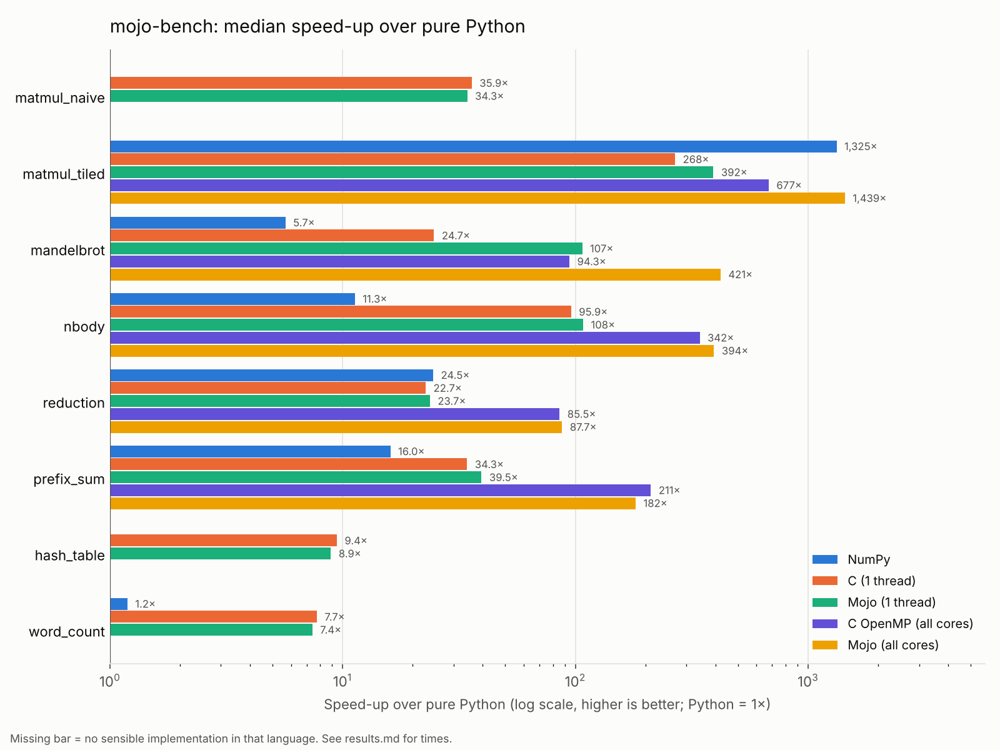

# mojo-bench

How fast is Mojo in practice? This repository compares **Mojo** with **pure Python**, **NumPy** and **C** on seven classic compute kernels, on the same machine, with the same inputs, checking that every implementation produces the same answer before any time is reported.

It is meant to be honest rather than flattering: where Mojo wins, the analysis says why; where it does not, that is reported too. Every number below was measured by `make bench` and is in [`results/results.csv`](results/results.csv).



## What is compared, and why

| Kernel | What it stresses | Size used |
|---|---|---|
| `matmul_naive` | Textbook i-j-k triple loop; strided memory access, no blocking | 384 × 384 float64 |
| `matmul_tiled` | Cache blocking + SIMD over the inner loop | 384 × 384 float64 |
| `mandelbrot` | Pure compute with a data-dependent early exit (branchy, hard to auto-vectorise) | 640 × 640 pixels, 200 max iterations |
| `nbody` | O(n²) floating-point maths with `sqrt` and division | 1,024 bodies, 5 steps |
| `reduction` | Streaming sum; memory bandwidth | 10 M int64 |
| `prefix_sum` | Inclusive scan; a serial dependency chain plus a write stream | 10 M int64 |
| `hash_table` | Random memory access, branches; 2 M inserts then 2 M lookups (50 % hits) | 2 M keys |

The implementations:

- **Python**: lists, loops and `dict`, written the way a competent Python programmer would without extension modules. This is the baseline (1×) and the source of truth for correctness.
- **NumPy**: the idiomatic "make Python fast" route, only where a natural array formulation exists. A naive triple loop and an open-addressing hash table have no sensible NumPy form, so they are shown as n/a. For `matmul_tiled`, NumPy's `a @ b` calls OpenBLAS: an expertly tuned GEMM, so treat it as the ceiling rather than a like-for-like peer.
- **C**: plain C11 compiled with `gcc -O3 -march=native`, no intrinsics. Any SIMD comes from GCC's auto-vectoriser, which is what most C code actually gets.
- **Mojo (1 thread)**: idiomatic Mojo 1.2 using explicit SIMD types and `vectorize` where it helps.
- **Mojo (all cores)**: the same code split into one chunk per core with `parallelize`, for the five kernels that parallelise naturally.

The fair, like-for-like comparison is **C (1 thread) against Mojo (1 thread)**. The parallel Mojo column shows what multi-threading adds on top. A multi-threaded C (OpenMP) comparison is part of the scaling study.

## Results

Machine: Intel Xeon (Sapphire Rapids, AVX-512) cloud VM with 4 vCPUs, Ubuntu 24.04, gcc 13.3.0, Mojo 1.2.0, Python 3.13.18, NumPy 2.5.3. Full details are in [`results/results.md`](results/results.md) and [`results/machine.json`](results/machine.json).

### Median time

| Kernel | Python | NumPy | C (1 thread) | Mojo (1 thread) | Mojo (4 threads) |
|---|---:|---:|---:|---:|---:|
| matmul_naive | 2.60 s | n/a | 69.1 ms | 70.8 ms | n/a |
| matmul_tiled | 2.51 s | 1.9 ms | 10.4 ms | 6.3 ms | 2.4 ms |
| mandelbrot | 2.08 s | 350.7 ms | 88.4 ms | 19.0 ms | 5.0 ms |
| nbody | 1.06 s | 94.4 ms | 10.4 ms | 9.4 ms | 2.6 ms |
| reduction | 75.2 ms | 3.0 ms | 3.4 ms | 3.8 ms | 851 µs |
| prefix_sum | 593.3 ms | 37.6 ms | 18.3 ms | 16.9 ms | 3.8 ms |
| hash_table | 1.04 s | n/a | 111.3 ms | 109.7 ms | n/a |

### Speed-up over pure Python (higher is better)

| Kernel | NumPy | C (1 thread) | Mojo (1 thread) | Mojo (4 threads) |
|---|---:|---:|---:|---:|
| matmul_naive | n/a | 37.7× | 36.8× | n/a |
| matmul_tiled | 1,335× | 241× | 400× | 1,049× |
| mandelbrot | 5.9× | 23.5× | 110× | 413× |
| nbody | 11.2× | 102× | 112× | 409× |
| reduction | 24.7× | 22.2× | 20.0× | 88.3× |
| prefix_sum | 15.8× | 32.4× | 35.0× | 156× |
| hash_table | n/a | 9.4× | 9.5× | n/a |

### Start-up and compile costs

| What | Median wall time |
|---|---:|
| Python interpreter start (no-op) | 17.2 ms |
| Python + `import numpy` (no-op) | 98.2 ms |
| C binary start (no-op) | 1.3 ms |
| Mojo binary start (no-op) | 8.8 ms |
| `gcc -O3` compile of `kernels.c` | 253 ms |
| `mojo build` of `kernels.mojo` | 1.89 s |
| `mojo run kernels.mojo` (JIT compile + run, no-op) | 1.89 s |

## Analysis: where Mojo wins, where it doesn't, and why

**Same algorithm, same machine code: no difference.** On `matmul_naive`, C and Mojo are within 3 % of each other (69.1 vs 70.8 ms, about 1.6 GFLOP/s each). Both are scalar loops walking down a column of B with a stride of 384 × 8 bytes, and neither compiler may reorder the floating-point sum. Mojo is not magic: written the same way as C, it compiles to much the same code (both go through an LLVM- or GCC-style optimiser) and runs at the same speed. The ~37× over Python is simply the cost of the interpreter.

**Explicit SIMD is where single-threaded Mojo pulls ahead.** The clearest case is `mandelbrot`: Mojo is **4.7× faster than C** on one core (19.0 vs 88.4 ms). The escape-time loop has a data-dependent exit, which GCC's auto-vectoriser will not touch, so the C code processes one pixel at a time. The Mojo version uses `SIMD[DType.float64, 8]` vectors, so 8 pixels per AVX-512 register, with a mask that freezes escaped lanes and a loop that ends when all 8 have escaped. This is the case Mojo is designed for: SIMD as a normal, portable type in the language rather than compiler-specific intrinsics. A C programmer *could* write the same thing with AVX-512 intrinsics. The point is that idiomatic C doesn't, and idiomatic Mojo does.

**Sometimes the difference is a compiler default, not the language.** On `matmul_tiled`, Mojo is 1.66× faster than C (6.3 vs 10.4 ms; 18.0 vs 10.8 GFLOP/s) with the same blocked i-k-j algorithm. The cause is measurable: GCC detects this CPU as Sapphire Rapids but defaults to `-mprefer-vector-width=256`, so it uses half-width AVX-512 vectors. Rebuilding the C with `-mprefer-vector-width=512` brought it to **6.6 ms**, level with Mojo. The same flag made the C n-body *slower* (10.3 → 14.7 ms), which is why GCC is cautious by default. Mojo's `simd_width_of[DType.float64]()` picks the full 8-lane width. To reproduce:

```bash
gcc -O3 -march=native -mprefer-vector-width=512 -std=c11 -o build/kernels_c512 kernels/c/kernels.c -lm
```

```bash
./build/kernels_c512 matmul_tiled 384 2 30
```

**When the compiler already vectorises, it's a tie.** On `nbody`, C and Mojo differ by about 10 % (10.4 vs 9.4 ms; roughly 500–550 M pair interactions per second). GCC auto-vectorises the inner loop of the C code, including `sqrt` and division, so writing it with explicit SIMD in Mojo gains little. The same applies to `reduction` (3.4 vs 3.8 ms) and `prefix_sum` (18.3 vs 16.9 ms): the differences are within the run-to-run noise described below.

**Memory-bound kernels: everyone hits the same wall.** A single core sums the 80 MB `reduction` array at about 21–26 GB/s in C, Mojo *and* NumPy. At that point the limit is how fast one core can pull data in, not the language. NumPy is level with compiled code here because `a.sum()` is a single call into a C loop with no per-element Python overhead. The 80 MB array does fit in the 260 MB of L3 that the VM reports, so after warm-up this is probably cache bandwidth rather than DRAM bandwidth. The roofline analysis returns to this.

**Pointer chasing: Python's dict is already C.** `hash_table` shows the smallest gap: C and Mojo do an insert or lookup in about 28 ns, Python in about 260 ns, so roughly 9.5×. Python's `dict` is a highly optimised C hash table, so what you pay for in Python is interpreter dispatch and boxed integers, not the hashing. The compiled versions are limited by cache misses on a 64 MB table, which no language feature removes.

**Parallelism is where the big numbers come from, and it isn't free.** With `parallelize` across 4 cores, Mojo reaches 3.6× (n-body) to 3.8× (Mandelbrot) over its own single-threaded code. Tiled matmul gets only 2.6×, because each thread's share at n = 384 is small and the run is only 2.4 ms. The reduction and scan show 4.4×, slightly above the ideal 4×, which is within the noise we measured for short parallel runs (see caveats); don't read it as super-linear speed-up. The best Mojo matmul, at 47 GFLOP/s on 4 cores, is still slower than single-threaded OpenBLAS at 60 GFLOP/s. A decade of hand-tuned micro-kernels (register blocking, packing, prefetching) still beats a straightforward tiled loop.

**Start-up and compile cost are real.** A compiled Mojo binary takes about 8.8 ms to start, against 1.3 ms for C: it initialises its runtime and thread pool. Compilation is the bigger cost: `mojo build` takes about 1.9 s for this file against 0.25 s for `gcc -O3`. `mojo run` pays that compile on *every* invocation, so for a script that does under a second of work, Python (17 ms to start) or a pre-built binary is the better choice. All kernel timings above exclude start-up and compilation.

### Summary

- Mojo is not a faster C. Written like C, it runs like C.
- Its advantage is that SIMD and parallelism are first-class and portable. `mandelbrot` (4.7× over C on one core) shows that clearly, and `parallelize` turns 4 cores into a 3.6–3.8× speed-up for compute-heavy kernels with a few lines of code.
- Compared with Python, the speed-ups are dramatic (10× to 1,000×), but most of that gain is also available from C. For array-shaped problems, NumPy gets a good part of the way there with no new language.

## Benchmarking caveats

- **One machine.** This is a 4-vCPU cloud VM (`hypervisor` flag set), shared with other tenants. Results will differ on your hardware, especially for memory-bound kernels.
- **Noise.** Repeats are adaptive: at least 5, otherwise as many as fit in about 1 s, capped at 200. Across two complete runs, medians agreed within about 3 % for most rows and within 7 % for every single-threaded row except NumPy n-body (13 %). Three of the very short 4-thread runs (tiled matmul, reduction and scan, all under 4 ms) varied by 10–20 % between runs, while their minimum times stayed within 8 %. Treat differences under about 10 % as a tie. Single-run figures quoted in the analysis (such as the `-mprefer-vector-width=512` experiment) were measured separately with 30 repeats.
- **Medians, warm caches.** Each implementation has one warm-up run, and times are medians of the timed repeats. Input generation is excluded, as is process start-up (measured separately above). Min, mean and standard deviation are in the CSV.
- **Sizes are set by pure Python.** Problem sizes were chosen so that pure Python takes 1–3 s per run. That makes several compiled runs short (milliseconds), which favours low-overhead code and limits parallel speed-up. Bigger problems would show the compiled languages scaling better.
- **Idiomatic, not heroic.** No implementation uses intrinsics, hand-written assembly or libraries other than NumPy. A determined C programmer can match every Mojo result here. The question this repo asks is what you get from reasonable code in each language.
- **Correctness first.** The runner exits with an error if any checksum disagrees with pure Python. Inputs come from integer formulas, so matmul, Mandelbrot, reduction, scan and hash-table checksums must match *exactly*. N-body sums floating-point forces in a different order in each implementation, so it allows a relative difference of 1e-9; the largest observed was about 3e-14.
- **Floating-point model.** No `-ffast-math`. GCC may contract `a*b+c` into FMA with `-march=native`, and Mandelbrot iteration counts still matched Python exactly at this size.
- **Toolchain versions matter.** Mojo is evolving quickly. In Mojo 1.x the standard library is imported as `std.*`, `UnsafePointer` gave way to `Pointer`, and `parallelize` moved to `max.algorithm` in the `max-core` package. The code here targets Mojo 1.2.0 and max-core 26.7.0 as pinned in `requirements.txt`.

## How to reproduce

Requirements: Linux x86-64 (the Mojo wheels need glibc ≥ 2.34), Python 3.10+ and gcc.

```bash
python3 -m pip install -r requirements.txt
```

```bash
make bench
```

`make bench` builds the C and Mojo code into `build/`, runs every kernel in every implementation, checks the answers, and rewrites `results/results.csv`, `results/results.md`, `results/machine.json`, `results/startup.csv` and `results/speedup.png`. It takes about two minutes on the machine above.

Other targets:

```bash
make quick
```

builds everything and runs a tiny-size correctness pass, which is what CI runs on every push and pull request.

```bash
python3 bench/run.py --kernels nbody mandelbrot --impls c mojo mojo_par
```

runs a subset.

Every implementation is also a standalone program with the same interface, e.g. `./build/kernels_mojo nbody 1024 1 10 4` (kernel, size, warm-up runs, timed repeats, threads).

## Repository layout

```
kernels/python/pure.py        pure-Python reference implementations
kernels/python/numpy_impl.py  NumPy implementations
kernels/python/harness.py     shared timing harness for the two above
kernels/c/kernels.c           C implementations
kernels/mojo/kernels.mojo     Mojo implementations (serial SIMD + parallel paths)
bench/run.py                  runner: correctness checks, timing, CSV/Markdown
bench/plot.py                 speed-up chart
results/                      the measured results shown above
```
